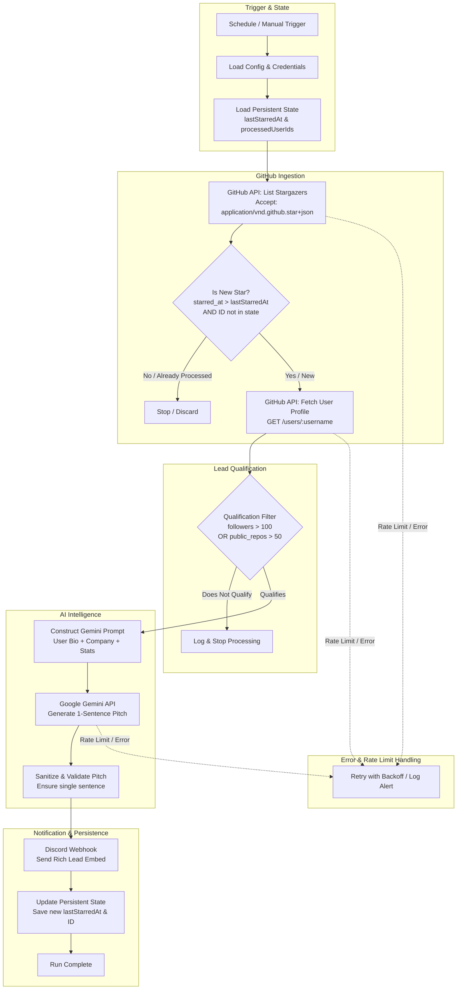

# Lead Sniper: System Architecture & Specification

## 1. Executive Summary
**Lead Sniper** is an automated lead generation and enrichment pipeline built in **n8n**. It autonomously monitors stargazers on a specified GitHub repository, detects newly added stargazers, enriches their profiles using GitHub's REST API, evaluates them against strict business qualification criteria, uses **Google Gemini** to generate a targeted single-sentence sales pitch, and alerts the team in **Discord** while maintaining persistent deduplication state and robust error handling.

---

## 2. End-to-End System Architecture



---

## 3. Detailed Component Specifications

### 3.1 GitHub Stargazers Polling & Delta Detection
- **API Endpoint:** `GET https://api.github.com/repos/{owner}/{repo}/stargazers?per_page=100&page=1`
- **Required Header:** `Accept: application/vnd.github.star+json`
- **Output Schema per Star:**
  ```json
  {
    "starred_at": "2026-11-10T14:32:00Z",
    "user": {
      "login": "octocat",
      "id": 583231,
      "url": "https://api.github.com/users/octocat"
    }
  }
  ```
- **Delta Identification Logic:**
  - GitHub returns stars in chronological order.
  - The workflow maintains `lastProcessedStarredAt` (ISO 8601 string) and an array of `processedUserIds` (set of numeric IDs).
  - A stargazer is classified as **New** if:
    1. `starred_at > lastProcessedStarredAt` (or when state is empty, processes latest batch without re-alerting historical data unless in bootstrap mode), AND
    2. `user.id` is not present in `processedUserIds`.

### 3.2 Persistent State Strategy
To prevent duplicate alerts across scheduled executions:
1. **Primary Mechanism (In-Workflow):** n8n Workflow Static Data via Code Node:
   ```javascript
   const staticData = $getWorkflowStaticData('global');
   staticData.lastStarredAt = staticData.lastStarredAt || null;
   staticData.processedIds = staticData.processedIds || [];
   ```
   *n8n persists this data across production runs automatically.*
2. **Secondary / Backup File Mechanism:** Write-back to `data/processed_leads.json` for exportability and standalone container execution.

### 3.3 Profile Enrichment
- **API Endpoint:** `GET https://api.github.com/users/{username}`
- **Extracted Fields:**
  - `login` (GitHub username)
  - `name` (Full name)
  - `company` (Company / Organization)
  - `bio` (User biography)
  - `followers` (Follower count)
  - `public_repos` (Public repository count)
  - `location` (Geographic location)
  - `blog` (Website / Portfolio URL)
  - `html_url` (Profile link)
  - `avatar_url` (Profile picture)

### 3.4 Qualification Filter Engine
- **Condition Rule:**
  $$\text{Qualifies} = (\text{followers} > 100) \lor (\text{public\_repos} > 50)$$
- **Requirement Rule:** Strict IF node in n8n.
  - **True Output:** Advances to Gemini AI Analysis.
  - **False Output:** Routed to a terminal No-Op / Disqualified node. No AI tokens spent, no Discord messages emitted.

### 3.5 AI Analysis Engine (Google Gemini)
- **Model:** `gemini-3.8-flash` (fast, cost-effective, high quality).
- **Endpoint:** `https://generativelanguage.googleapis.com/v1beta/models/gemini-3.8-flash:generateContent`
- **System / Prompt Instruction:**
  > "You are an elite B2B sales intelligence analyst. Analyze the following GitHub profile data for a lead who starred our developer tool.
  >
  > Name: {{ $json.name || $json.login }}
  > Bio: {{ $json.bio || 'Not provided' }}
  > Company: {{ $json.company || 'Not provided' }}
  > Public Repos: {{ $json.public_repos }}
  > Followers: {{ $json.followers }}
  >
  > Task: Generate EXACTLY ONE sentence explaining why this user could be a valuable lead based on their technical activity, company, or reach.
  >
  > Constraints:
  > - Strict requirement: Output MUST be exactly one single sentence.
  > - Do NOT include markdown bold, bullet points, quotes, or preambles.
  > - Be specific, punchy, and commercially insightful."
- **Sanitization Post-Processor:** Code node to strip trailing quotes, multiple sentences, or whitespace to ensure strict single-sentence compliance.

### 3.6 Discord Webhook Dispatch
- **Endpoint:** `POST {DISCORD_WEBHOOK_URL}`
- **Rich Embed Schema:**
  - **Title:** `🎯 Qualified GitHub Lead Detected: @{login}`
  - **URL:** `{html_url}`
  - **Color:** `0x5865F2` (Discord Blurple) or `0x2ECC71` (Lead Green)
  - **Author:** Name + Avatar
  - **Fields:**
    - 🏢 Company: `{company}`
    - 👥 Followers: `{followers}`
    - 📦 Public Repos: `{public_repos}`
    - 📍 Location: `{location}`
    - 📝 Bio: `{bio}`
    - 💡 **AI Lead Angle:** `{gemini_pitch}`
  - **Footer:** `Lead Sniper • Repository: {owner}/{repo}`
  - **Timestamp:** Current ISO timestamp

### 3.7 Rate Limiting, Retries & Error Handling
1. **GitHub API:**
   - Authenticated rate limit: 5,000 requests/hour.
   - n8n HTTP Request node configured with:
     - `Retry on Fail: true`
     - `Max Tries: 3`
     - `Wait Between Tries: 2000 ms`
2. **Gemini API:**
   - 429 Rate Limit backoff retry policy.
3. **Error Handling Node:**
   - n8n `Error Trigger` node or failure sub-route to capture unrecoverable network failures without crashing the scheduled job.

---

## 4. Security & Compliance
- **Zero Hardcoded Secrets:** All credentials (`GITHUB_TOKEN`, `GEMINI_API_KEY`, `DISCORD_WEBHOOK_URL`) reside in n8n credential objects or environment expressions (`{{ $env.GITHUB_TOKEN }}`).
- **Least Privilege:** GitHub PAT requires only read access to public user data.
- **Fail-safe Deduplication:** Ensures zero spamming or duplicate notifications on Discord.

